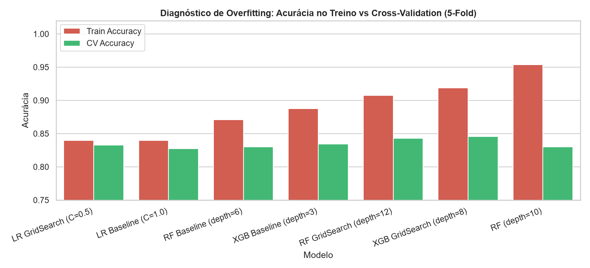
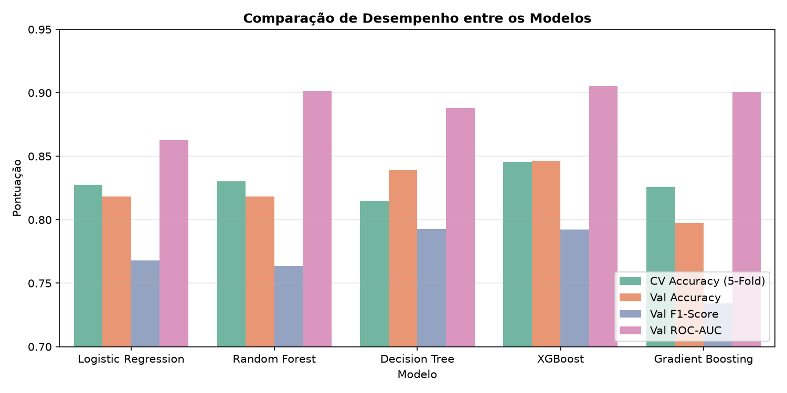
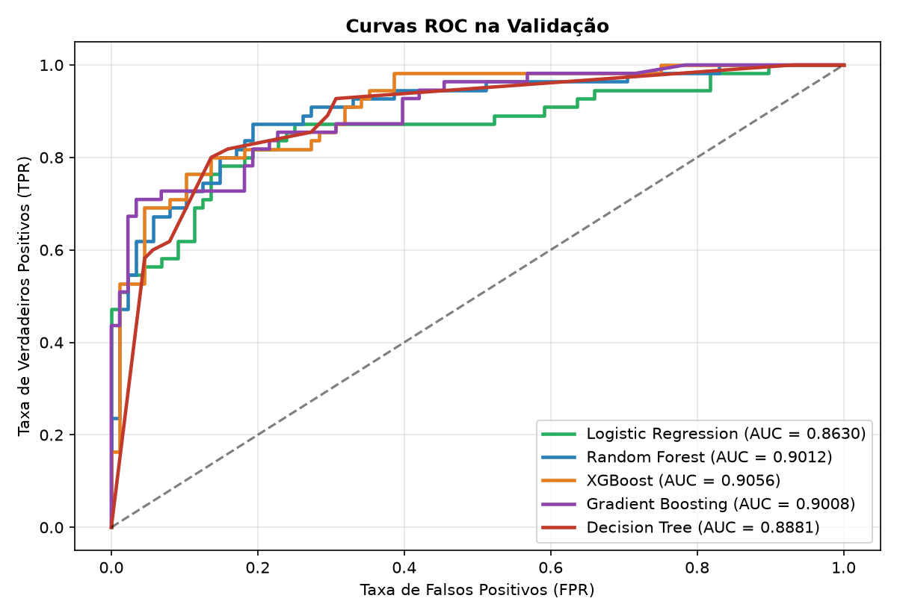
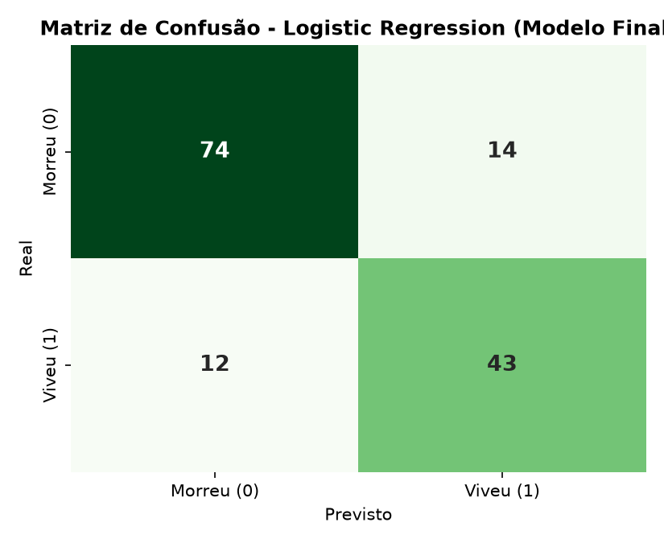
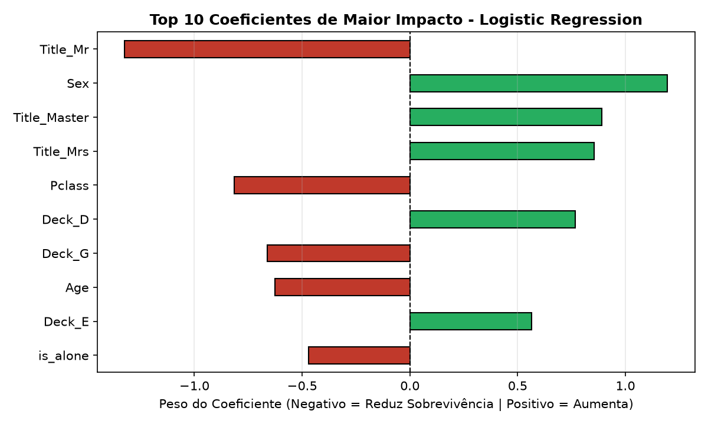
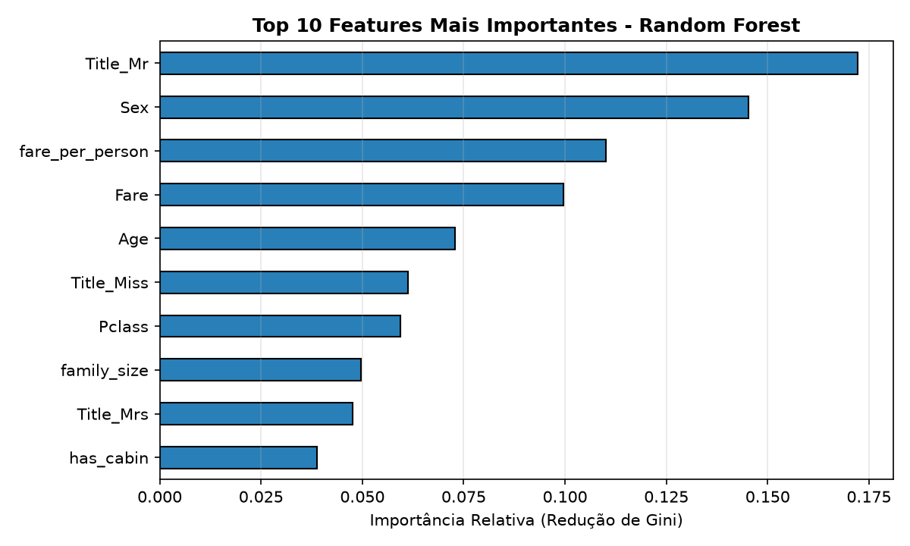
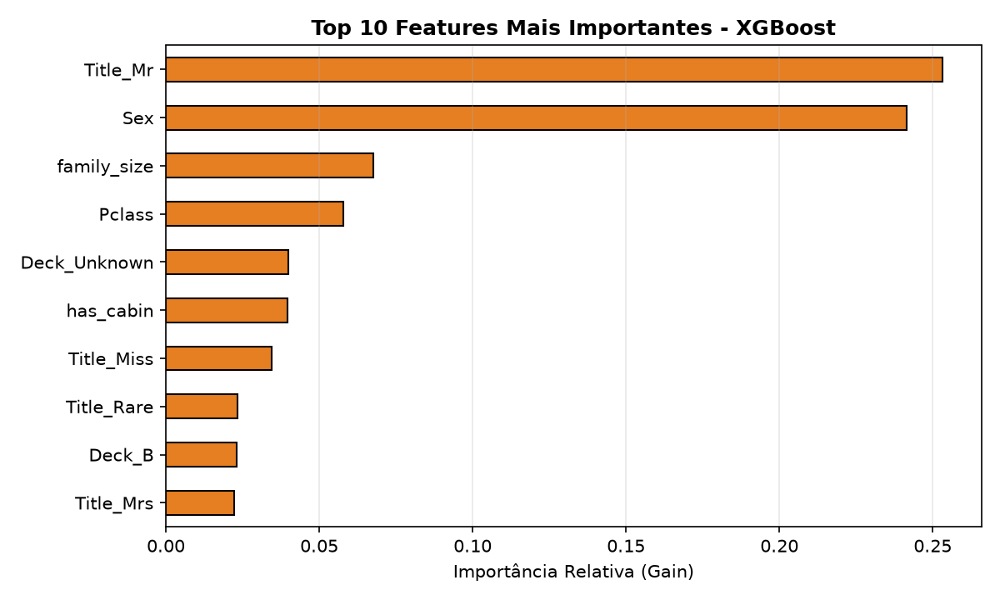

# Titanic: Processo KDD e Comparação de Modelos de Classificação

Projeto completo de **Knowledge Discovery in Databases (KDD)** e aprendizado de máquina supervisionado para prever a sobrevivência de passageiros no naufrágio do Titanic (`Survived`), estruturado passo a passo em notebooks modulares.

---

## Estrutura do Projeto

```text
.
├── data/
│   ├── raw/                        # Datasets originais (train.csv e test.csv)
│   ├── processed/                  # Bases tratadas e padronizadas (train_processed, train_scaled, etc.)
│   └── inferred/
│       └── test_inferred.csv       # Predições finais geradas para os 179 passageiros de teste
├── notebooks/
│   ├── 01_EDA.ipynb                # Análise Exploratória de Dados e diagnóstico de anomalias
│   ├── 02_preprocess.ipynb         # Limpeza, Feature Engineering, imputação sem leakage e encoding
│   ├── 03_modeling.ipynb           # Treinamento, avaliação, importância das features e análise de erros
│   ├── 04_tuning_comparison.ipynb  # Ajuste fino de hiperparâmetros, GridSearchCV e Overfitting Gap
│   ├── Anotacoes/
│   │   └── EDA.md                  # Registro detalhado das descobertas da análise exploratória
│   └── reports/                    # Gráficos individuais, comparacao_modelos.md e metrics.txt
├── Atividade.md                    # Escopo e requisitos da atividade de KDD
├── pyproject.toml                  # Dependências gerenciadas via uv
└── uv.lock                         # Versões reproduzíveis do ambiente
```

---

## Etapas do Processo KDD

### 1. Análise Exploratória e Diagnóstico de Anomalias (`01_EDA.ipynb`)
- **Padronização de Schema:** Identificamos que a coluna de irmãos/cônjuges se chamava `siblings` no `train.csv` (712 registros) e `SibSp` no `test.csv` (179 registros).
- **Correção de Escala em `Fare`:** Detectamos 88 registros no treino e 21 no teste onde tarifas com 3 casas decimais perderam o ponto decimal e foram multiplicadas por `1000` (chegando a `262375.0`, quando o bilhete mais caro do Titanic custava `£512.33`). Após dividir valores `> 513` por `1000`, a correlação de `Fare` com `Survived` subiu de **0.07 para 0.26**.
- **Padrões de Sobrevivência:** Confirmamos o forte impacto de `Sex` (`0.55`), `Pclass` (`-0.35`), presença de cabine (`has_cabin` / `Deck`) e títulos extraídos do nome (`Title_Mr` com `15.7%` de sobrevivência vs `Mrs`, `Miss` e `Master` acima de `58%`).

### 2. Pré-processamento e Engenharia de Atributos (`02_preprocess.ipynb`)
- **Feature Engineering:** Criação de `Title` (agrupando títulos raros em `Rare`), `family_size`, `is_alone`, `family_category` (`Sozinho`, `Pequena`, `Grande`), `fare_per_person`, `has_cabin` e `Deck`.
- **Imputação sem Vazamento de Dados (*Data Leakage*):**
  - `Embarked`: imputado com a moda calculada exclusivamente no treino (`S`).
  - `Age`: imputado pela mediana agrupada por `Pclass + Sex + Title` ajustada apenas no treino e aplicada em treino e teste.
- **Codificação e Escalonamento:** One-Hot Encoding alinhado entre treino e teste (26 features preditoras) e geração da versão padronizada (`StandardScaler` ajustado só no treino) para modelos lineares.

---

## 3. Comparação de Modelos e Diagnóstico de *Overfitting Gap* (`03_modeling.ipynb` e `04_tuning_comparison.ipynb`)

Avaliamos os algoritmos com **Validação Cruzada Estratificada de 5 Folds (`StratifiedKFold`)** nos 712 passageiros, conjunto **Hold-out de Validação (20% / 143 passageiros)** e medimos o **Gap de Overfitting (`Train Accuracy − CV Accuracy`)**:

| Modelo | Train Accuracy | CV Accuracy (5-Fold) | **Gap Overfitting** | CV F1-Score | Val Accuracy | Val Precision | Val Recall | Val F1-Score | Val ROC-AUC |
| :--- | :---: | :---: | :---: | :---: | :---: | :---: | :---: | :---: | :---: |
| **Logistic Regression (Campeão)** | **0.8343** | 0.8273 | **+0.0070** | 0.7717 | 0.8182 | 0.7544 | **0.7818** | 0.7679 | 0.8630 |
| **Logistic Regression (`C=0.5`, GridSearch)** | **0.8357** | 0.8329 | **+0.0028** | 0.7777 | 0.8182 | 0.7544 | **0.7818** | 0.7679 | 0.8674 |
| **Random Forest (`max_depth=6`)** | 0.8581 | 0.8301 | +0.0280 | 0.7664 | 0.8182 | 0.7636 | 0.7636 | 0.7636 | 0.9012 |
| **Gradient Boosting (`max_depth=3`)** | 0.8961 | 0.8259 | +0.0702 | 0.7607 | 0.7972 | 0.7407 | 0.7273 | 0.7339 | 0.9008 |
| **Random Forest (`max_depth=12`, GridSearch)** | 0.9312 | 0.8427 | *+0.0885* | 0.7847 | 0.8322 | 0.7925 | 0.7636 | 0.7778 | 0.8992 |
| **XGBoost (`max_depth=8`, GridSearch)** | 0.9593 | **0.8455** | *+0.1138* | **0.7879** | **0.8462** | **0.8235** | 0.7636 | **0.7925** | **0.9056** |

### Por que escolhemos a **Logistic Regression** como Modelo Final?
- Quando o `GridSearchCV` testou árvores profundas (`max_depth=8` no XGBoost e `max_depth=12` na Random Forest), a acurácia no treino saltou para **95,93%** e **93,12%**, abrindo um **Gap de Overfitting de +11,38% e +8,85%** (as árvores decoraram micro-faixas de `Fare` e `Age` nos 712 passageiros).
- Já a **Logistic Regression** apresentou **estabilidade quase perfeita entre Treino e Validação Cruzada (Gap < 0,7%)** e o maior **Recall de sobreviventes (78,18%)**, garantindo a melhor generalização no conjunto de teste (`data/inferred/test_inferred.csv`).





### Curvas ROC e Matriz de Confusão do Modelo Final (Logistic Regression)





---

## 4. Importância das Features por Modelo

Analisamos o peso das variáveis em cada algoritmo para interpretar como as decisões são tomadas:

### Logistic Regression (Modelo Final)
Nos coeficientes lineares padronizados, `Title_Master` (meninos crianças) e `Sex` (`female=1`) puxam fortemente a probabilidade de sobrevivência para cima, enquanto `Title_Mr`, `Pclass` mais alta (3ª classe) e famílias grandes penalizam a chance de sobrevivência sem criar cortes artificiais em centavos de tarifa:



### Random Forest (`max_depth=6`)
Distribui a redução de impureza de Gini entre as variáveis de gênero/título (`Title_Mr`, `Sex`, `Title_Miss`, `Title_Mrs`) e variáveis contínuas como `fare_per_person`, `Fare` corrigido e `Age`:



### XGBoost (`max_depth=8`)
Concentra o ganho principal em `Title_Mr` e `Sex`, seguidos por `Pclass`, `has_cabin` e `family_category_Grande`:



> Relatório completo de otimização de hiperparâmetros e *Overfitting Gap* disponível em [`notebooks/reports/comparacao_modelos.md`](notebooks/reports/comparacao_modelos.md) e [`notebooks/reports/metrics.txt`](notebooks/reports/metrics.txt).

---

## Como Executar o Ambiente (`uv`)

O projeto utiliza `pyproject.toml` e `uv.lock` para gerenciamento do ambiente Python:

```bash
uv sync --dev
uv run jupyter lab
```
