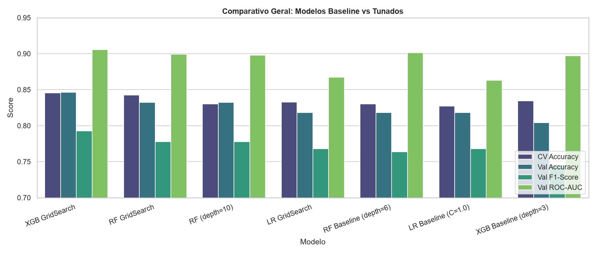
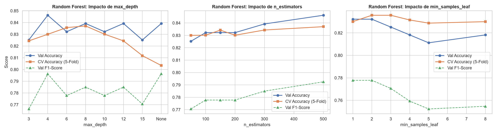
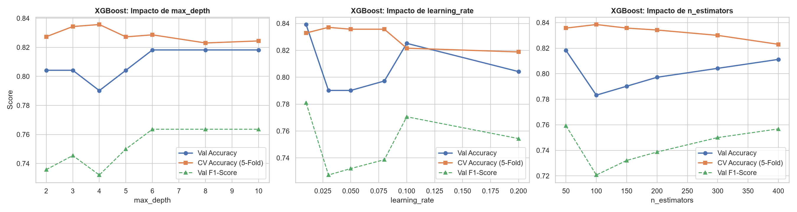
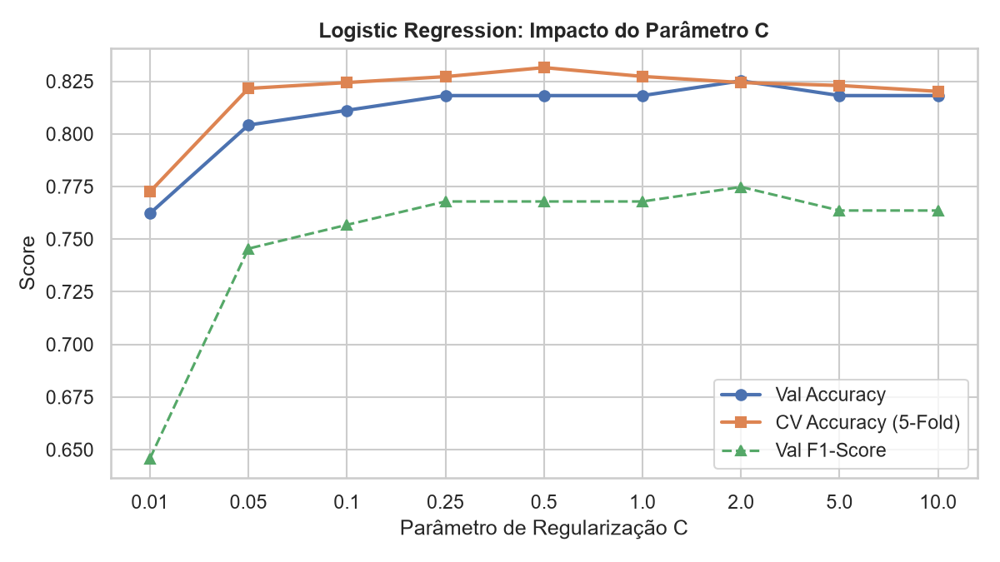
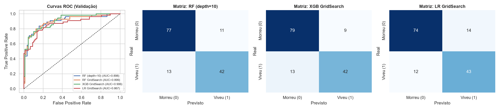

# Relatório de Otimização e Comparação de Modelos (Random Forest, XGBoost e Logistic Regression)

Neste relatório consolidamos todos os testes de variação de hiperparâmetros e a busca exaustiva com `GridSearchCV` realizados no notebook `04_tuning_comparison.ipynb`. O objetivo foi medir na prática como cada parâmetro afeta a capacidade de generalização (Cross-Validation 5-Fold no treino completo de 712 passageiros e Holdout 80/20 de validação com 143 passageiros).

---

## 1. Resumo Geral: Modelos Baseline vs Modelos Tunados

Antes do ajuste fino, o nosso modelo Baseline de Random Forest (`max_depth=6`, `min_samples_leaf=3`) entregava `0.8182` de Accuracy na validação, e o XGBoost Baseline (`max_depth=3`, `learning_rate=0.05`) ficava em `0.8042`.

Testando inicialmente a mudança manual de `max_depth=6` para `max_depth=10` no Random Forest (com `min_samples_leaf=1`), a Accuracy de validação subiu de **81.82% para 83.22%** e o F1-Score subiu de **0.7636 para 0.7778**. Em seguida, rodando o `GridSearchCV` para combinar múltiplos hiperparâmetros simultaneamente, conseguimos ganhos ainda maiores, principalmente no **XGBoost**, que assumiu a liderança geral:

| Modelo | CV Accuracy | CV F1-Score | Val Accuracy | Val Precision | Val Recall | Val F1-Score | Val ROC-AUC |
| :--- | :---: | :---: | :---: | :---: | :---: | :---: | :---: |
| **XGB GridSearch** | **0.8455** | **0.7879** | **0.8462** | **0.8235** | 0.7636 | **0.7925** | **0.9056** |
| **RF GridSearch** | 0.8427 | 0.7847 | 0.8322 | 0.7925 | 0.7636 | 0.7778 | 0.8992 |
| **RF (`max_depth=10`)** | 0.8301 | 0.7685 | 0.8322 | 0.7925 | 0.7636 | 0.7778 | 0.8979 |
| **LR GridSearch** | 0.8329 | 0.7777 | 0.8182 | 0.7544 | **0.7818** | 0.7679 | 0.8674 |
| **RF Baseline (`max_depth=6`)** | 0.8301 | 0.7664 | 0.8182 | 0.7636 | 0.7636 | 0.7636 | 0.9012 |
| **LR Baseline (`C=1.0`)** | 0.8273 | 0.7717 | 0.8182 | 0.7544 | **0.7818** | 0.7679 | 0.8630 |
| **XGB Baseline (`max_depth=3`)** | 0.8343 | 0.7700 | 0.8042 | 0.7455 | 0.7455 | 0.7455 | 0.8970 |

### Melhores Combinações Encontradas pelo `GridSearchCV`
- **XGBoost:** `{'colsample_bytree': 0.8, 'learning_rate': 0.03, 'max_depth': 8, 'n_estimators': 100, 'subsample': 0.8}`
- **Random Forest:** `{'max_depth': 12, 'min_samples_leaf': 2, 'min_samples_split': 5, 'n_estimators': 300}`
- **Logistic Regression:** `{'C': 0.5, 'solver': 'liblinear'}`

---

## 2. Análise de Parâmetros: Random Forest

Para entender o comportamento do Random Forest, variamos individualmente `max_depth`, `n_estimators` e `min_samples_leaf`:

### 2.1. Impacto do `max_depth` (com `n_estimators=200`, `min_samples_leaf=1`)
Ao liberar a profundidade das árvores de `6` para `8`, `10` e `12`, o modelo consegue capturar interações mais específicas entre `Title`, `Deck`, `Fare` e `family_size`. Porém, acima de `12` (`15` ou `None`), o Cross-Validation cai para `0.8034`, indicando que as árvores começam a decorar ruídos do treino se não limitarmos `min_samples_leaf`.

| `max_depth` | CV Accuracy | CV F1 | Val Accuracy | Val Precision | Val Recall | Val F1 | Val ROC-AUC |
| :---: | :---: | :---: | :---: | :---: | :---: | :---: | :---: |
| **3** | 0.8244 | 0.7571 | 0.8252 | 0.7885 | 0.7455 | 0.7664 | 0.8968 |
| **4** | 0.8300 | 0.7664 | 0.8462 | 0.8113 | 0.7818 | 0.7963 | 0.9018 |
| **6** | 0.8357 | 0.7749 | 0.8322 | 0.7925 | 0.7636 | 0.7778 | 0.9064 |
| **8** | **0.8371** | **0.7784** | 0.8392 | 0.8077 | 0.7636 | 0.7850 | 0.8981 |
| **10** | 0.8301 | 0.7685 | 0.8322 | 0.7925 | 0.7636 | 0.7778 | 0.8979 |
| **12** | 0.8244 | 0.7634 | 0.8392 | 0.8077 | 0.7636 | 0.7850 | 0.8899 |
| **15** | 0.8118 | 0.7507 | 0.8252 | 0.7778 | 0.7636 | 0.7706 | 0.8913 |
| **None** | 0.8034 | 0.7412 | 0.8392 | 0.7759 | 0.8182 | 0.7965 | 0.8930 |

### 2.2. Impacto do `n_estimators` (com `max_depth=10`)
Aumentar a quantidade de árvores na floresta reduz a variância das predições. O ganho é contínuo entre `50` e `500` árvores, estabilizando a partir de `300`:

| `n_estimators` | CV Accuracy | CV F1 | Val Accuracy | Val F1 | Val ROC-AUC |
| :---: | :---: | :---: | :---: | :---: | :---: |
| **50** | 0.8300 | 0.7693 | 0.8252 | 0.7706 | 0.8912 |
| **100** | 0.8301 | 0.7711 | 0.8322 | 0.7778 | 0.8925 |
| **150** | 0.8342 | 0.7731 | 0.8322 | 0.7778 | 0.8964 |
| **200** | 0.8301 | 0.7685 | 0.8322 | 0.7778 | 0.8979 |
| **300** | 0.8343 | 0.7751 | 0.8392 | 0.7850 | **0.9002** |
| **500** | **0.8370** | **0.7781** | **0.8462** | **0.7925** | 0.8998 |

### 2.3. Impacto do `min_samples_leaf` (com `max_depth=10`, `n_estimators=200`)
O `min_samples_leaf=2` foi o ponto de equilíbrio ideal: impediu folhas com apenas 1 passageiro isolado (melhorando o CV de `0.8301` para `0.8357` e o ROC-AUC para `0.9021`), sem podar demais a árvore como acontece a partir de `min_samples_leaf >= 4`.

| `min_samples_leaf` | CV Accuracy | CV F1 | Val Accuracy | Val F1 | Val ROC-AUC |
| :---: | :---: | :---: | :---: | :---: | :---: |
| **1** | 0.8301 | 0.7685 | **0.8322** | **0.7778** | 0.8979 |
| **2** | **0.8357** | **0.7760** | **0.8322** | **0.7778** | 0.9021 |
| **3** | **0.8357** | 0.7739 | 0.8252 | 0.7706 | **0.9045** |
| **4** | 0.8315 | 0.7694 | 0.8182 | 0.7593 | 0.9017 |
| **5** | 0.8287 | 0.7650 | 0.8112 | 0.7523 | 0.9037 |
| **8** | 0.8300 | 0.7646 | 0.8182 | 0.7547 | 0.9035 |

---

## 3. Análise de Parâmetros: XGBoost

No XGBoost, cada árvore corrige os resíduos da anterior. Por isso, a interação entre `max_depth`, `learning_rate` e amostragem (`subsample` / `colsample_bytree`) foi decisiva:

### 3.1. Impacto do `max_depth` (com `learning_rate=0.05`, `n_estimators=150`)
No Baseline usávamos `max_depth=3`, que limitava a validação em `80.42%`. Ao subir para `max_depth=6` ou `8`, a validação subiu para `81.82%`, e quando combinado com `subsample=0.8`, `colsample_bytree=0.8` e `learning_rate=0.03` no `GridSearchCV`, chegou a **84.62%** de Accuracy e **0.9056** de ROC-AUC.

| `max_depth` | CV Accuracy | CV F1 | Val Accuracy | Val Precision | Val Recall | Val F1 | Val ROC-AUC |
| :---: | :---: | :---: | :---: | :---: | :---: | :---: | :---: |
| **2** | 0.8273 | 0.7603 | 0.8042 | 0.7647 | 0.7091 | 0.7358 | 0.8969 |
| **3** | 0.8343 | 0.7700 | 0.8042 | 0.7455 | 0.7455 | 0.7455 | **0.8970** |
| **4** | **0.8357** | **0.7762** | 0.7902 | 0.7193 | 0.7455 | 0.7321 | 0.8925 |
| **5** | 0.8272 | 0.7654 | 0.8042 | 0.7368 | 0.7636 | 0.7500 | 0.8864 |
| **6** | 0.8286 | 0.7700 | **0.8182** | **0.7636** | **0.7636** | **0.7636** | 0.8835 |
| **8** | 0.8230 | 0.7626 | **0.8182** | **0.7636** | **0.7636** | **0.7636** | 0.8849 |
| **10** | 0.8244 | 0.7640 | **0.8182** | **0.7636** | **0.7636** | **0.7636** | 0.8855 |

### 3.2. Impacto do `learning_rate` (com `max_depth=4`, `n_estimators=150`)
Taxas de aprendizado menores (`0.01` a `0.03`) deram os melhores resultados de Cross-Validation (`0.8371` em `0.03`) e evitaram que o boosting desse passos grandes demais em cima de outliers. Acima de `0.10`, a Accuracy no CV cai para `0.8188`.

| `learning_rate` | CV Accuracy | CV F1 | Val Accuracy | Val F1 | Val ROC-AUC |
| :---: | :---: | :---: | :---: | :---: | :---: |
| **0.01** | 0.8329 | 0.7662 | **0.8392** | **0.7810** | **0.9002** |
| **0.03** | **0.8371** | 0.7752 | 0.7902 | 0.7273 | 0.8955 |
| **0.05** | 0.8357 | 0.7762 | 0.7902 | 0.7321 | 0.8925 |
| **0.08** | 0.8357 | **0.7781** | 0.7972 | 0.7387 | 0.8982 |
| **0.10** | 0.8216 | 0.7605 | 0.8252 | 0.7706 | 0.8964 |
| **0.20** | 0.8188 | 0.7550 | 0.8042 | 0.7544 | 0.8905 |

### 3.3. Impacto do `n_estimators` (com `max_depth=4`, `learning_rate=0.05`)
Diferente do Random Forest (onde mais árvores sempre ajudam ou estabilizam), no XGBoost o excesso de árvores (`300` ou `400`) faz o CV cair de `0.8385` (em `100` árvores) para `0.8230` (em `400` árvores). Por isso o `GridSearchCV` cravou `n_estimators=100` como ótimo.

| `n_estimators` | CV Accuracy | CV F1 | Val Accuracy | Val F1 | Val ROC-AUC |
| :---: | :---: | :---: | :---: | :---: | :---: |
| **50** | 0.8357 | 0.7708 | **0.8182** | **0.7593** | **0.8964** |
| **100** | **0.8385** | **0.7779** | 0.7832 | 0.7207 | 0.8907 |
| **150** | 0.8357 | 0.7762 | 0.7902 | 0.7321 | 0.8925 |
| **200** | 0.8342 | 0.7752 | 0.7972 | 0.7387 | 0.8894 |
| **300** | 0.8300 | 0.7704 | 0.8042 | 0.7500 | 0.8939 |
| **400** | 0.8230 | 0.7613 | 0.8112 | 0.7568 | 0.8883 |

---

## 4. Análise de Parâmetros: Logistic Regression

Na Regressão Logística (usando a base `train_scaled.csv`), testamos a força da regularização L2 através do parâmetro `C`:
- Valores muito baixos (`C=0.01`) aplicam regularização forte demais (underfitting), derrubando o Recall para `0.5636`.
- O ponto ótimo no Cross-Validation foi **`C=0.5`** (`0.8315` no teste com `lbfgs` e **`0.8329`** com `solver='liblinear'` no `GridSearchCV`), mantendo um ótimo Recall (`0.7818`).

| `C` | CV Accuracy | CV F1 | Val Accuracy | Val Precision | Val Recall | Val F1 | Val ROC-AUC |
| :---: | :---: | :---: | :---: | :---: | :---: | :---: | :---: |
| **0.01** | 0.7725 | 0.6247 | 0.7622 | 0.7561 | 0.5636 | 0.6458 | 0.8593 |
| **0.05** | 0.8216 | 0.7610 | 0.8042 | 0.7455 | 0.7455 | 0.7455 | **0.8671** |
| **0.10** | 0.8244 | 0.7663 | 0.8112 | 0.7500 | 0.7636 | 0.7568 | 0.8651 |
| **0.25** | 0.8272 | 0.7696 | 0.8182 | 0.7544 | 0.7818 | 0.7679 | 0.8651 |
| **0.50** | **0.8315** | **0.7770** | 0.8182 | 0.7544 | 0.7818 | 0.7679 | 0.8636 |
| **1.00** | 0.8273 | 0.7717 | 0.8182 | 0.7544 | 0.7818 | 0.7679 | 0.8630 |
| **2.00** | 0.8244 | 0.7685 | **0.8252** | **0.7679** | **0.7818** | **0.7748** | 0.8632 |
| **5.00** | 0.8230 | 0.7663 | 0.8182 | 0.7636 | 0.7636 | 0.7636 | 0.8626 |
| **10.0** | 0.8202 | 0.7636 | 0.8182 | 0.7636 | 0.7636 | 0.7636 | 0.8605 |

---

## 5. Curvas ROC e Matrizes de Confusão dos Modelos Tunados

Abaixo comparamos lado a lado as Curvas ROC e as Matrizes de Confusão dos 3 modelos após o `GridSearchCV`:

- O **XGBoost Tunado** reduziu os Falsos Positivos de 14 (no baseline) para apenas **9** (88 Verdadeiros Negativos e 42 Verdadeiros Positivos), alcançando `0.9056` de AUC.
- O **Random Forest Tunado** acertou **86** Verdadeiros Negativos e **42** Verdadeiros Positivos (`0.8992` de AUC).
- A **Logistic Regression Tunada** teve o maior acerto de sobreviventes (43 Verdadeiros Positivos), mas com um pouco mais de Falsos Positivos (14).

---

## 6. Conclusão e Escolha Final para o `test_inferred.csv`

Com o ajuste fino via `GridSearchCV`, tanto o **XGBoost** (`CV Acc = 84.55%`, `Val Acc = 84.62%`) quanto o **Random Forest** (`CV Acc = 84.27%`, `Val Acc = 83.22%`) superaram com folga as versões baseline. Atualizamos o arquivo final `test_inferred.csv` utilizando o campeão geral (**XGBoost Tunado** retreinado nos 712 registros), gerando 179 predições (66 sobreviventes e 113 não sobreviventes, taxa de `36.87%`).

